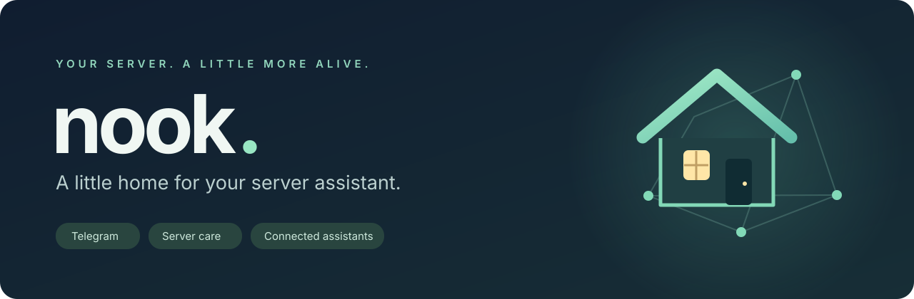

# Nook

Персональный администратор Linux-сервера в Telegram. Пишешь обычным языком — Nook проверяет состояние, читает логи и выполняет задачи. Помнит устройство сервера между разговорами, следит за службами и спрашивает разрешение на опасные действия.

**Предварительная версия 0.1.0.** Открытый проект: https://github.com/Sppqq/nook. Основной язык интерфейса — русский. Лицензия — [MIT](../LICENSE).

## Главное преимущество — попроси его улучшить самого себя

**Описываешь нужную возможность в чате — Nook может сам реализовать её в своей установке.** Добавить кнопку в меню, подключить сервис, написать навык или фоновую задачу: реализацию берёт на себя помощник. Он может прочитать свой код, написать Python-мод, проверить его и подключить поддерживаемые моды без перезапуска бота. Более крупные изменения могут затронуть ядро — с резервной копией, проверкой и перезапуском, когда он нужен.

Например, просьба «свяжи мои копии, чтобы они могли общаться» превратилась в [модуль связи](PEERS.md), кнопку в Telegram и тесты. Навыки и отдельно настраиваемые интеграции позволяют добавлять инструменты и сохранять инструкции по их использованию. Всё выполняется в пределах прав Linux-пользователя и настроек подтверждения; результат нужно проверять.

**Этот публичный репозиторий подготовил и опубликовал сам Домовой** — помощник, из которого вырос Nook, — по просьбе хозяина. В работу вошли подготовка открытых исходников, документация, установщик, баннер, тесты и обновления на GitHub. Хозяин задаёт направление, помощник выполняет разработку. У сторонних инструментов и зависимостей остаются собственные авторы и лицензии.

## Возможности

- Диалог через Telegram, файлы, фотографии, кнопки, очередь задач и остановка выполнения.
- Codex CLI, Google Antigravity CLI и Mercury; выбор модели и глубины в меню, просмотр доступных квот. Доступность моделей зависит от провайдера и аккаунта.
- Mercury как быстрая или резервная модель, с кнопкой «Продолжить» в том же разговоре.
- Память в Markdown, инвентарь проектов, наблюдение за CPU, памятью, диском и службами.
- Управление своими нодами по SSH, отложенные задания, отслеживание изменений и проверка после исправлений.
- Настройки интерфейса через «Меню → Настройки»: видимость кнопок под ответами и в главном меню, иконки, цвета, один столбик, наборы «Минимум / Стандарт / Всё». Изменения сохраняются сразу; скрытые разделы доступны в «Ещё».
- Моды на Python: дополнительные кнопки, обработчики и фоновые задачи.
- Необязательный root-помощник с подтверждением команд в Telegram.

## Чем Nook удобнее OpenClaw и Hermes Agent

**Выбирай Nook, если хочешь серверного помощника, которого можно попросить расширить самого себя прямо из Telegram.** Главный акцент — развитие через обычный диалог, вместе с готовыми инструментами администратора и настраиваемым интерфейсом бота.

- **Обслуживание серверов уже встроено.** Наблюдение за службами и ресурсами, инвентарь проектов, SSH-ноды, отложенное обслуживание и проверка после исправлений работают в одном процессе. Guard сравнивает снимки системы и замечает изменения; `watchfix` при провале зарегистрированной проверки будит агента для разбора или восстановления из копии. Реестр, ноды и проверки нужно настроить под свои серверы.
- **Повседневное управление — кнопками в Telegram.** Выбор модели, доступные квоты, остановка задачи, продолжение Mercury и подтверждение привилегированных команд. В настройках меняются видимость кнопок, расположение, цвета и премиум-эмодзи.
- **Можно использовать привычные инструменты моделей.** Nook запускает Codex CLI и Antigravity CLI, а Mercury может подхватить работу при исчерпании квоты Codex. Аккаунты и ключи нужны свои; лимиты и стоимость определяются провайдерами.
- **Бота легко расширять на Python.** Локальные моды добавляют кнопки, обработчики и фоновые задачи; заметки о сервере хранятся в редактируемом Markdown.

[OpenClaw](https://github.com/openclaw/openclaw#readme) стоит выбрать для широкого персонального ассистента в разных мессенджерах и приложениях. У него есть Gateway, веб-интерфейс управления, инструменты, навыки и плагины.

[Hermes Agent](https://github.com/NousResearch/hermes-agent#readme) стоит выбрать для универсального агента с терминальным интерфейсом, обучением на опыте, созданием навыков, поиском по истории, разными средами исполнения и интеграциями с мессенджерами.

Telegram и расширяемость есть и у обоих проектов — сами по себе это не уникальные возможности Nook. Сравнение описывает подходящие задачи по официальным README, проверенным 6 ноября 2026 года; документация по ресурсам проверена 7 ноября 2026 года. Сравнительных замеров скорости, стоимости, надёжности и безопасности нет. Nook пока предварительная версия: интерфейс русский, установку на чистый VPS ещё предстоит проверить.

## Потребление ресурсов: Nook, OpenClaw и Hermes

В таблице — **требования к развёртыванию из документации, а не замеры потребления процессов**:

| Проект | Оперативная память | Процессор |
| --- | --- | --- |
| Nook | В этой инструкции рекомендуется около 2 ГБ для графиков и необязательных голосовых; минимум не установлен | Минимум не установлен |
| OpenClaw | Абсолютный минимум — 1 ГБ | Минимум — 1 ядро |
| Hermes Agent (Docker) | Минимум — 1 ГБ; рекомендуется 2–4 ГБ | Минимум — 1 ядро; рекомендуется 2 |

Источники: [официальный FAQ OpenClaw](https://docs.openclaw.ai/help/faq-first-run/quick-start) и [официальные требования Hermes для Docker](https://hermes-agent.nousresearch.com/docs/user-guide/docker#resource-limits), проверены 7 ноября 2026 года. Для браузерных инструментов Hermes рекомендует хотя бы 2 ГБ. Наши 2 ГБ — начальная рекомендация, а не проверенный предел для любой нагрузки.

**Реальный основной процесс нашего бота занимал около 103 МиБ RSS.** Замерен Домовой — работающая установка, из которой выделен Nook: 7 ноября 2026 года три чтения Linux `/proc/<pid>/status` с интервалом в секунду показали одинаковое `VmRSS: 105384 kB`. Бот работал во время задачи по документации; это не замер простоя свежей установки Nook. В число не входят дочерние процессы агента, браузер, локальное распознавание голосовых и остальные службы сервера.

Одинаковую нагрузку на всех трёх проектах мы пока не проверяли. Память отдельного процесса нельзя напрямую сравнивать с требованиями к целому серверу или выдавать за доказательство меньшего общего расхода RAM и CPU. Браузер, локальные модели, голосовые и параллельные задачи заметно меняют потребление. Сопоставимых замеров CPU и пиковой памяти пока нет.

## Связь с копиями

- [Связь с другими копиями](PEERS.md): сообщения через SSH, парные ключи и необязательные автоответы без доступа к командам.

## Обновление без переустановки

Открой **Ещё → Моды → Обновить Nook**: помощник проверит GitHub и предложит подтвердить обновление. Настройки, память, переписка, ключи и свои расширения сохраняются. При конфликте с местными правками обновление отменится. Перед заменой кода будет резервная копия; отдельный процесс дождётся завершения задач, перезапустит бота и откатит код, если запуск не пройдёт проверку. Изменения зависимостей или формата данных требуют отдельной миграции.

[Обновление и восстановление](UPDATES.md) · Проверка из терминала: `bin/nook-update check`. Автоматический перезапуск рассчитан на пользовательскую `nook.service` от установщика. Старым установкам сначала нужен проверенный перенос обновлятора. Повторно запускать установщик ради обновления не нужно.

## Установка

Нужен свой Linux-сервер: рекомендуется Ubuntu 24.04 или Debian 12+ (на Ubuntu 22.04 отдельно нужен Python 3.11+), Python 3.11+, systemd и обычный пользователь с sudo. Установщик использует apt, поэтому другие дистрибутивы пока не поддержаны. Для графиков и голосовых желательно от 2 ГБ RAM.

Установка одной командой в интерактивном SSH-терминале:

```bash
curl -fsSL https://raw.githubusercontent.com/Sppqq/nook/main/bootstrap.sh | bash
```

Мастер предложит выбрать модели и голосовые, покажет настройки перед установкой, скроет ввод токена и отобразит прогресс. Исходники загружаются с GitHub и проверяются по манифесту.

Если хочешь сначала посмотреть код, клонируй https://github.com/Sppqq/nook, перейди в папку `nook` и выполни:

```bash
bash install.sh --check
bash install.sh
```

Запускай в интерактивном SSH-терминале от обычного пользователя, не от root. Мастер запросит:

1. Токен своего бота от Telegram @BotFather.
2. Свой числовой Telegram ID — только этот пользователь сможет управлять ботом.
3. Вход в собственные аккаунты моделей и, при необходимости, API-ключ Mercury.

Установщик создаёт `~/nook`, изолированное Python-окружение и пользовательскую службу. Существующий бот не перезаписывается. Токен и ключ вводятся скрыто, файлы с ними получают права 600. Длинные журналы установки: `~/.cache/nook/install.log`. Часовой пояс по умолчанию — Europe/Moscow.

Для Antigravity мастер откроет интерактивный вход: открой ссылку в своём браузере, войди в Google и заверши вход в терминале. После входа выйди из клиента, чтобы установка продолжилась. Авторизация провайдера сама по себе не гарантирует наличие квоты или мощности у выбранной модели.

После установки открой своего бота в Telegram и напиши ему. В первый запуск он осмотрит сервер без изменений. Не запускай две копии бота с одним Telegram-токеном.

### Настройки установки

```bash
bash install.sh --target "$HOME/my-nook" --timezone Europe/Berlin
bash install.sh --skip-antigravity --skip-mercury  # Только Codex
bash install.sh --skip-codex --skip-antigravity   # Только Mercury
bash install.sh --voice                          # Локальное распознавание голосовых
bash install.sh --no-start                       # Подготовить, не запускать
bash install.sh --no-system-packages             # Системные зависимости уже установлены
```

Флаги `--skip-codex`, `--skip-antigravity`, `--skip-mercury` пропускают отдельные провайдеры. В мастере по умолчанию выбран набор Codex. Если установлен только Mercury или Antigravity, установщик сразу выберет соответствующую модель. `--yes` пропускает выбор набора и подтверждение плана, сохраняя явно переданные флаги; вход в аккаунты остаётся интерактивным. Ключ Mercury нужен свой, с платформы Inception Labs; API может быть платным. Для автоматизации доступен `--mercury-key-file /путь/к/приватному/файлу`.

Продолжить прерванную настройку моделей:

```bash
bash install.sh --providers-only --target "$HOME/nook"
# Если установка прервалась до создания службы:
bash install.sh --finish-service --target "$HOME/nook"
```

После повторной настройки моделей перезапусти пользовательскую службу.

### Управление службой

```bash
systemctl --user status nook.service
journalctl --user -u nook.service -n 80 --no-pager
systemctl --user restart nook.service
```

Для работы после выхода из SSH мастер включает linger. Контейнеры без пользовательского systemd/DBus требуют своего менеджера процессов: `.venv/bin/python bot.py`. Whisper-модель скачивается при первом голосовом сообщении и требует отдельного места на диске.

## Права и доверие

**Nook исполняет команды на сервере и может менять свои файлы.** Это инструмент для владельца сервера. Аккаунт бота имеет доступ к файлам своего Linux-пользователя; запуск модели использует автономный режим с разрешёнными инструментами. Правила в `AGENTS.md` помогают управлять поведением, но не являются изоляцией или гарантией безопасности.

Начинай с отдельного пользователя или тестового VPS. Не давай боту доступ к чужим данным. Внешние сообщения, документы и сайты могут содержать вредоносные инструкции. Проверяй команды, требующие повышения прав. Включение полного root-доступа разрешает выполнение без отдельного подтверждения до истечения срока.

Необязательная установка root-помощника, **из папки установленного бота**:

```bash
sudo bash setup/install-root.sh
```

Установщик дополнительно запросит подтверждение и проверит sudoers. После установки обслуживание служб, чтение журналов и некоторые операции apt доступны без пароля. Остальные root-команды проходят через Telegram-подтверждение `rootdo`. Этот помощник не защищает от компрометации самого аккаунта бота: см. [SECURITY.md](../SECURITY.md).

## Данные и расширения

В Git хранятся исходники и пустые образцы в `templates/runtime/`. Реальные `config.json`, `secrets.env`, `state.json`, `memory/`, `spool/`, `keys/`, `nodes.json`, `ssh_config`, переписки, файлы и логи создаются локально и исключены через `.gitignore`. Авторизация Codex и Antigravity хранится отдельно в домашней папке пользователя. Не публикуй установленную папку и не прикладывай её целиком к issue.

Реестр проектов после установки — `memory/registry.json`, изначально пустой. `bin/projects --refresh` обновляет снимок; список проектов заполняется владельцем или агентом по твоему запросу. Status Board и система резервных копий — отдельные интеграции, в комплект не входят. Внешние GitHub, MCP, DNS и другие сервисы требуют собственной настройки.

Моды `owner_api` и `openbot_bridge` включены как дополнительные исходники и **выключены по умолчанию**. Для OpenBot нужны собственная установка и реестр агентов; API-клиенты находятся в `setup/nook-api/`. Навыки лежат в `.agents/skills/`, примеры модов — `mods/_example.py`.

## Разработка и проверка

```bash
python3 -m unittest discover -s tests -v
python3 tools/build_release.py
bash install.sh --check
```

Тесты установщика работают во временной папке с подменёнными сетевыми и системными операциями. Они не устанавливают пакеты и не запускают настоящего бота. Публикационный архив создаётся только из файлов, перечисленных Git, и проходит отдельную проверку состава. Контрольные суммы обнаруживают повреждение; они не заменяют доверие к источнику скачивания.

См. [CONTRIBUTING.md](../CONTRIBUTING.md), [CHANGELOG.md](../CHANGELOG.md) и [ARCHITECTURE.md](ARCHITECTURE.md).

## Текущие ограничения

Некоторые административные операции ориентированы на Ubuntu/Debian. Автоматический откат зависит от доступности процесса бота и не заменяет резервную копию. API провайдеров, лимиты, доступность моделей и расширенные функции Telegram могут изменяться. Поведение будущей публичной сборки на совершенно чистом VPS ещё нужно проверить; используй отдельный тестовый сервер перед рабочей установкой.

### Необязательный выбор аккаунтов Codex

Мод `mods/codex_accounts.py` требует отдельную утилиту `codex-auth` с командами `list`, `switch` и `import`. Она не входит в этот выпуск, поэтому мод выключен по умолчанию. Обычный вход Codex через меню работает отдельно. Включайте мод только после установки совместимой утилиты и проверки на своих аккаунтах.

Проверка безопасности: [находки, исправления и ограничения от 2026-11-07](SECURITY-AUDIT.md).
